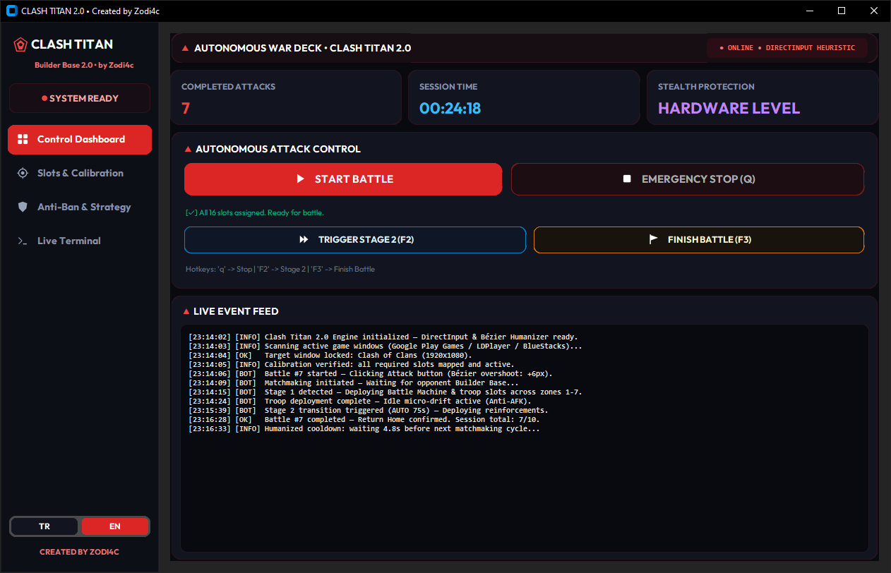
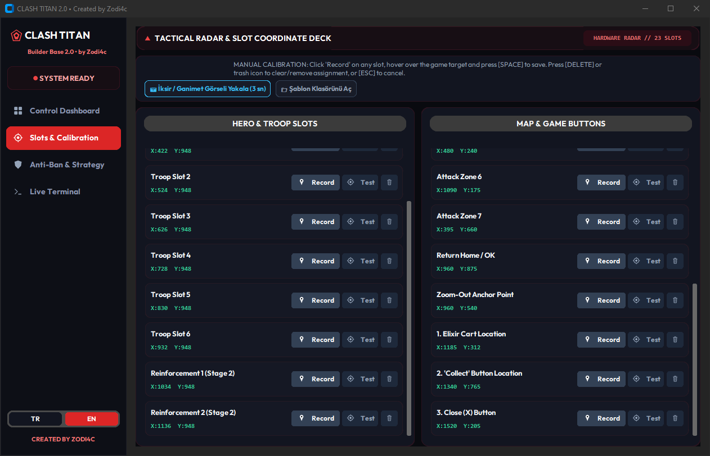
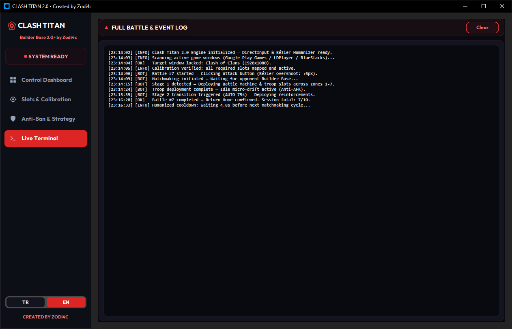

# Clash Titan 2.0 — Builder Base Automation Suite

<div align="center">

[](README.md)
[](README.tr.md)
[](https://github.com/Zodi4ctvn)


**A luxury, hardware-level autonomous Builder Base 2.0 attack automation suite for Clash of Clans on Windows.**  
**Created by [Zodi4c](https://github.com/Zodi4ctvn).**  
*Türkçe kullanım kılavuzu için [README.tr.md](README.tr.md) dosyasına bakabilirsiniz.*

</div>


<div align="center">



*Clash Titan 2.0 — Control Dashboard (English UI)*

</div>

---

## Interface Showcase

Explore every screen and built-in safety system of **Clash Titan 2.0** (full **English** & **Türkçe** live-switching interface):

<table>
  <tr>
    <td align="center" width="50%">
      
      <br/>
      <b>1. Control Dashboard</b><br/>
      <sub>Live attack counter, session timer, DirectInput status HUD, quick hotkeys (<code>Q</code> / <code>F2</code> / <code>F3</code>), and real-time event feed.</sub>
    </td>
    <td align="center" width="50%">
      
      <br/>
      <b>2. Slots &amp; Calibration (Hero, Troops &amp; Map)</b><br/>
      <sub>One-click Record (<code>SPACE</code> / Left Click), live Test click verification, and instant slot deletion for all 23 points.</sub>
    </td>
  </tr>
  <tr>
    <td align="center" width="50%">
      
      <br/>
      <b>3. Slots &amp; Calibration (Stage 2 &amp; Elixir Cart)</b><br/>
      <sub>Stage 2 reinforcements, Return Home / OK, Zoom-Out anchor point, and automated Elixir Cart collection points.</sub>
    </td>
    <td align="center" width="50%">
      
      <br/>
      <b>4. Anti-Ban &amp; Strategy (Ultra Stealth Preset)</b><br/>
      <sub>Real-time heuristic safety score, one-click stealth preset, battle pacing sliders, break algorithm, and instant language switch.</sub>
    </td>
  </tr>
  <tr>
    <td align="center" width="50%">
      
      <br/>
      <b>5. Live Anti-Ban Risk Analyzer (High-Risk Alert)</b><br/>
      <sub>Dynamically flags aggressive break intervals, rushed Stage 2 delays, or excessive micro-clicks in real time.</sub>
    </td>
    <td align="center" width="50%">
      
      <br/>
      <b>6. Live Terminal (Full Battle &amp; Event Log)</b><br/>
      <sub>Detailed timestamped telemetry for window lock, Bézier overshoot, stage transitions, and humanized cooldowns.</sub>
    </td>
  </tr>
  <tr>
    <td align="center" colspan="2">
      
      <br/>
      <b>7. Missing Slot Safety Guardrail</b><br/>
      <sub>Blocks battle launch when any required coordinate is missing, lists every unassigned slot, and redirects to calibration.</sub>
    </td>
  </tr>
</table>

---

## Overview


> [!NOTE]
> **Tested Emulator:** This bot has only been tested on **Google Play Games (PC)**. Other emulators (LDPlayer, BlueStacks, MEmu, etc.) should be compatible in theory but have **not been verified**. Use at your own risk.
**Clash Titan 2.0** is an advanced, non-intrusive GUI automation tool designed for Clash of Clans Builder Base (Yan Köy) on PC. Fully compatible with **all Android emulators and platforms** including **LDPlayer 9, BlueStacks 5, GameLoop, Google Play Games PC, MEmu Play, NoxPlayer, MuMu Player**, and Windows Subsystem for Android (WSA). Built with an emphasis on **heuristic human simulation** and **anti-detection**, it operates strictly at the OS input level without injecting into process memory or modifying game files. Features full bilingual support (**English & Türkçe**).


---

## Key Features

- **Universal Android Emulator Support:** Automatically scans, identifies, focuses, and locks onto any active game window across LDPlayer, BlueStacks, GameLoop, Google Play Games PC, MEmu, NoxPlayer, MuMu, and WSA.
- **Hardware-Level Input Engine (DirectInput):** Dispatches physical mouse events via native Windows `user32.mouse_event`, bypassing emulator input filtering with 100% reliability.
- **Biometric Mouse Trajectory:**
  - Non-linear cubic Bézier curve paths with natural ease-in / ease-out acceleration.
  - **Overshoot & Micro-Correction:** Emulates human hand physics by dynamically overshooting buttons by 4–10 px with 35% probability before correcting back.
  - **Gauss Distribution:** Click durations and reaction intervals follow a log-normal/Gaussian bell curve rather than linear randoms.
  - **Idle Micro-Drift:** Eliminates AFK bot flags by making subtle micro-movements while observing battles.
- **Builder Base 2.0 Dual-Stage Architecture:**
  - **Dedicated Slot Coordinates:** Deploys Hero and all 6 individual troop slots precisely without drifting onto troop active abilities.
  - **Flexible Stage 2 Transition:** Automatic timer-based trigger or manual hotkey (`F2`) trigger when Stage 1 is cleared quickly.
  - **Early Battle Dismissal:** Checks for battle completion and double-taps return screens to bank loot and return to base instantly.
- **Luxury CustomTkinter Interface:**
  - Modern dark obsidian & emerald UI without child-like emojis.
  - Custom supersampled vector icons (`icons.py`).
  - **Dynamic Anti-Ban Risk Meter & Instant Auto-Save:** Real-time heuristic AI safety calculation displaying live ban risk percentages and recommendations (Green / Amber / Red indicators). Single-click **Apply Recommended Stealth Preset** button. All changes persist automatically without manual save buttons.
  - Live mouse coordinate HUD, real-time battle counters, and dynamic session timers.
  - Interactive **Manual Calibration Tab** with Left Click or `[SPACE]` key binding and live click testing.
  - **Missing Slot Safety Guardrail:** Prevents starting battles if any of the 16 calibration points are unassigned, displaying a detailed warning modal listing the missing slots and redirecting to the calibration tab.
- **Global Hotkey Controls:**
  - `q` — Emergency Kill Switch (terminates instantly)
  - `p` — Pause / Resume
  - `F2` — Manual Stage 2 Transition (deploys reinforcements)
  - `F3` — Manual Finish Battle (dismisses result screens and returns home)

---

## Project Structure

```
coc-bb-autoattack/
├── ClashTitan.bat           # Primary one-click launcher (GUI & auto-installer)
├── main.py                  # Primary application entrypoint (GUI / CLI / Wizard)
├── gui.py                   # Luxury CustomTkinter dashboard
├── bot.py                   # Core state machine & autonomous battle runner
├── locales.py               # Bilingual localization engine (English & Türkçe)
├── human_mouse.py           # Hardware-level DirectInput & Bézier heuristic engine
├── icons.py                 # Vector icon generation engine (monochrome, supersampled)
├── vision.py                # OpenCV template matching module
├── setup_wizard.py          # Standalone interactive calibration wizard
├── config.py                # Central strategy, timing, and anti-ban configuration
├── coordinates.example.json # Template calibration schema
├── coordinates.json         # Local user-calibrated screen coordinates
├── requirements.txt         # Pinned Python package dependencies
├── README.md                # English documentation
├── README.tr.md             # Türkçe dokümantasyon
├── .gitignore               # Comprehensive Git ignore rules
├── LICENSE                  # MIT open-source license
└── templates/               # Button template images (.gitkeep tracked)
```

---

## Installation

### Prerequisites
- **Operating System:** Windows 10 / Windows 11 (x64)
- **Python:** Python 3.11 or newer

### 1. Clone the Repository
```bash
git clone https://github.com/Zodi4ctvn/coc-bb-autoattack.git
cd coc-bb-autoattack
```

### 2. Install Dependencies
```bash
python -m pip install -r requirements.txt
```

---

## Quick Start

### Running the Dashboard
Double-click `ClashTitan.bat` or run:
```bash
python main.py
```

### Running in Headless / CLI Mode
```bash
python main.py --cli
```

### Running the Calibration Wizard
```bash
python main.py --wizard
```

---

## Calibration Workflow

1. Launch your emulator (LDPlayer, BlueStacks, GameLoop, Google Play Games, etc.) and open Clash of Clans (Builder Base).
2. Open **Clash Titan 2.0** and navigate to the **Slot & Kalibrasyon** tab.
3. For each slot or button:
   - Click **`Kaydet`** (or **`Record`**).
   - Hover your mouse cursor over the target button on the game window.
   - **`Left Click`** or press **`[SPACE]`** on your keyboard (a confirmation tone will sound).
   - *(To cancel, press **`[ESC]`** or click the record button again).*
4. Use the **`Test`** button to verify that the cursor moves and clicks the target accurately.
5. Return to the **Kontrol Merkezi** tab and click **`SAVAŞI BAŞLAT`**.

---

## Configuration (`config.py`)

Key parameters can be adjusted via the UI or directly in `config.py`:
- `attacks_before_break`: Number of attacks before enforcing a human-like break (default: `11`).
- `stage2_wait_seconds`: Cooldown before auto-deploying Stage 2 reinforcements (default: `75s`).
- `clicks_per_troop_slot`: Clicks deployed per slot to guarantee empty drops (default: `4`).
- `click_jitter_radius`: Pixel offset randomization radius for map deployment (default: `12px`).

---

## Disclaimer & Fair Play Notice

> [!WARNING]
> **Terms of Service Disclosure:**
> Automating gameplay in Clash of Clans violates Supercell's *Terms of Service* and *Safe and Fair Play Policy*. Using automated macros carries an inherent risk of account suspension or permanent bans.
> 
> This software is provided strictly for **educational, testing, and research purposes**. The authors assume no liability for account penalties, bans, or data loss resulting from the use of this software. Use conservatively and at your own discretion.

---

## Author

Created and maintained by **[Zodi4c](https://github.com/Zodi4ctvn)**.  
Feedback, contributions, and issues are welcome!

---

## License

[](LICENSE)

This project is licensed under a **Custom Non-Commercial Attribution License**.

**Key restrictions:**
- ✅ Personal & educational use is allowed
- ❌ Commercial use is **prohibited**
- ❌ Removing or modifying the Zodi4c author credit is **prohibited**
- ❌ Redistributing as your own project is **prohibited**
- ❌ Relicensing under any other license is **prohibited**

See the [LICENSE](LICENSE) file for full details.


