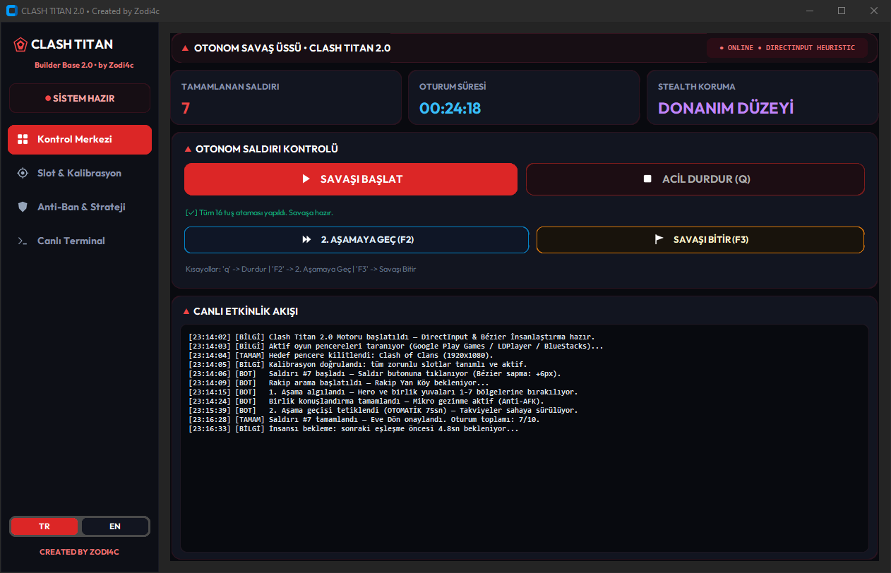
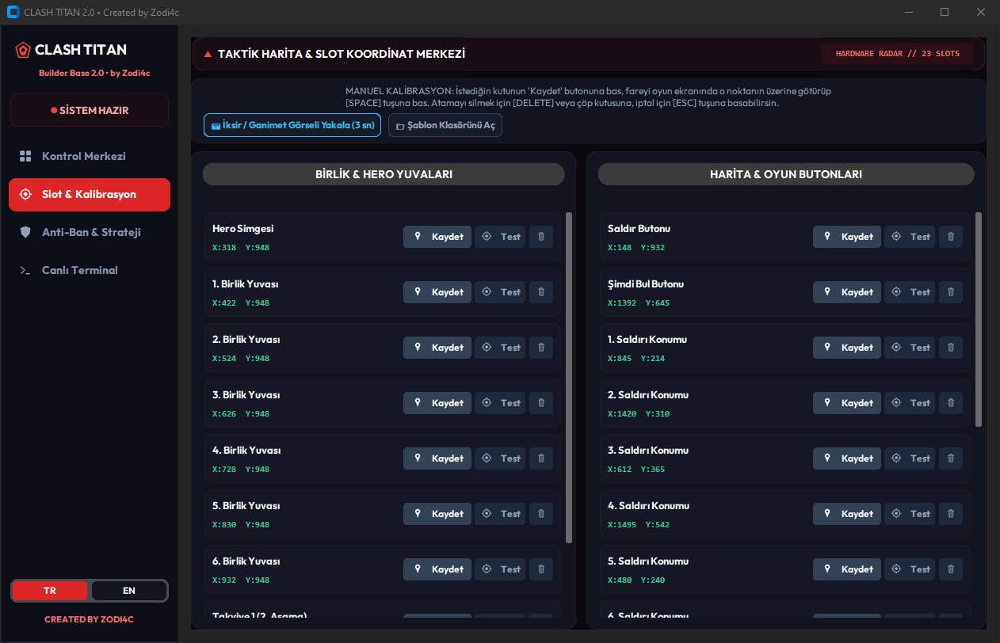
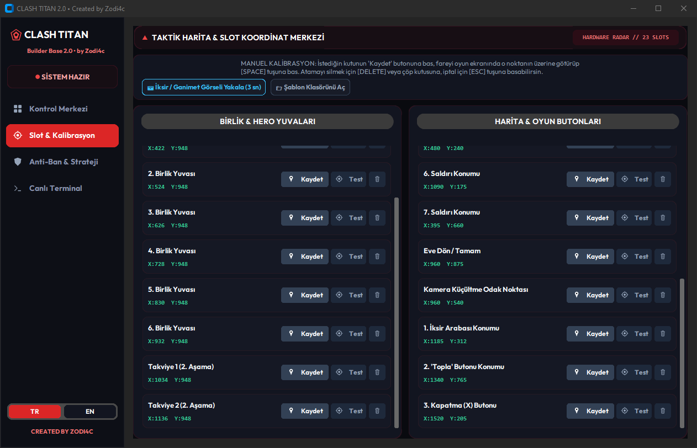
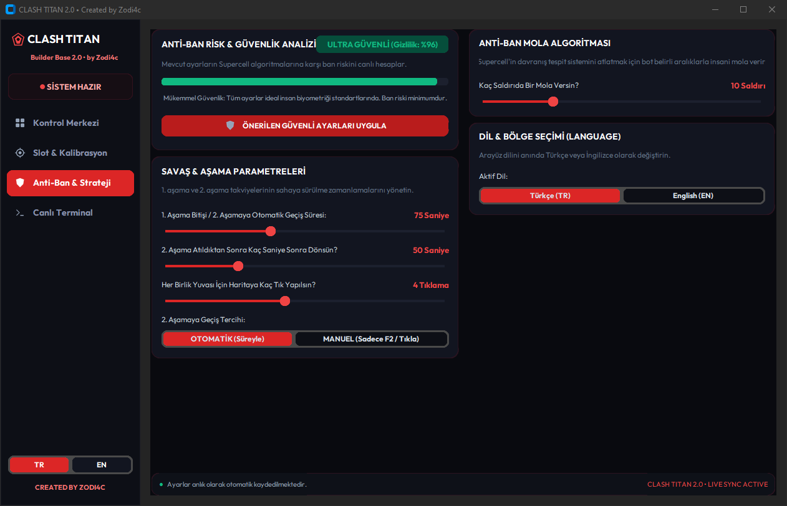
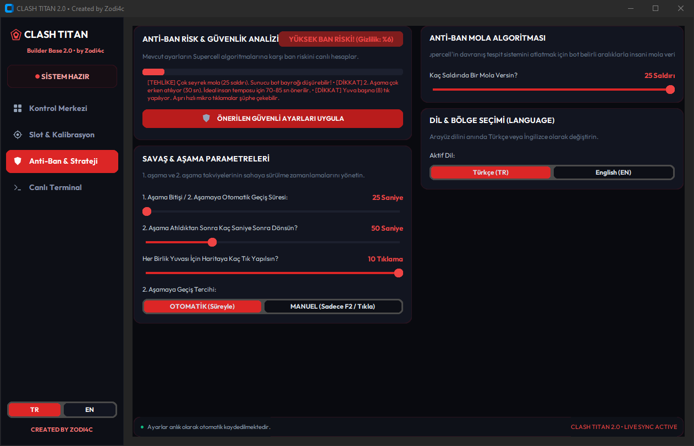
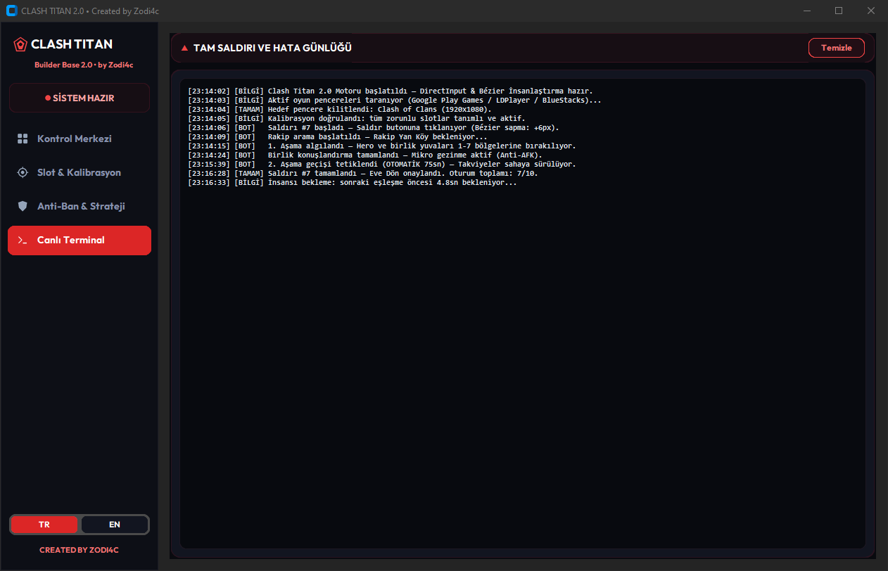
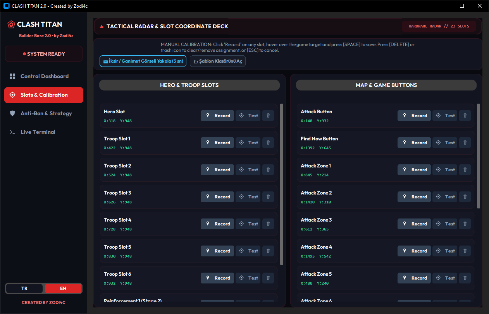
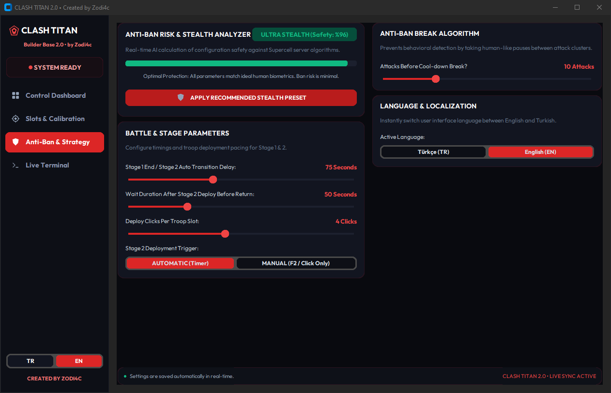
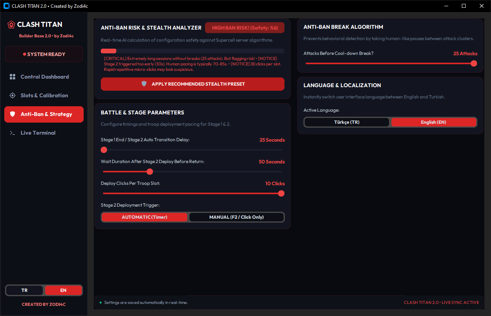
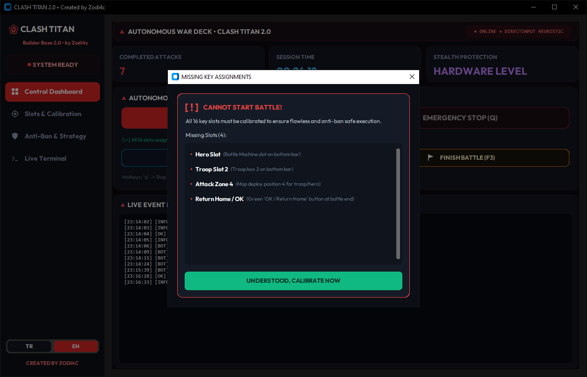

# Clash Titan 2.0 — Builder Base Automation Suite

<div align="center">

**[🇹🇷 Türkçe](#-türkçe) · [🇬🇧 English](#-english)**

[](https://github.com/zodi4ctvn)


[](LICENSE)


**Hardware-level, anti-ban autonomous Builder Base 2.0 attack automation suite for Clash of Clans on Windows.**  
**Created by [Zodi4c](https://github.com/zodi4ctvn).**

</div>

---

## 🇹🇷 Türkçe

<div align="center">



*Clash Titan 2.0 — Kontrol Merkezi (Türkçe Arayüz)*

</div>

### Arayüz & Özellik Galerisi

**Clash Titan 2.0** kontrol panelinin tüm sekmelerini ve yerleşik güvenlik mekanizmalarını inceleyin (**Türkçe** ve **İngilizce** anlık dil geçişi desteklenir):

<table>
  <tr>
    <td align="center" width="50%">
      
      <br/>
      <b>1. Kontrol Merkezi</b><br/>
      <sub>Canlı saldırı sayacı, oturum süresi, donanım seviyesi stealth göstergesi, hızlı kısayollar (<code>Q</code> / <code>F2</code> / <code>F3</code>) ve canlı etkinlik akışı.</sub>
    </td>
    <td align="center" width="50%">
      
      <br/>
      <b>2. Slot &amp; Kalibrasyon (Hero, Birlikler &amp; Harita)</b><br/>
      <sub>Tek tıkla Kaydet (<code>SPACE</code> / Sol Tık), canlı Test tıklaması ve toplam 23 nokta (19 zorunlu + 4 opsiyonel) için anlık atama yönetimi.</sub>
    </td>
  </tr>
  <tr>
    <td align="center" width="50%">
      
      <br/>
      <b>3. Slot &amp; Kalibrasyon (2. Aşama &amp; İksir Arabası)</b><br/>
      <sub>2. aşama takviye yuvaları, Eve Dön / Tamam, kamera küçültme odak noktası ve otomatik İksir Arabası toplama noktaları.</sub>
    </td>
    <td align="center" width="50%">
      
      <br/>
      <b>4. Anti-Ban &amp; Strateji (Ultra Güvenli Ayar)</b><br/>
      <sub>Canlı sezgisel güvenlik ölçer, tek tıkla önerilen güvenli preset, savaş zamanlama sürgüleri, mola algoritması ve anlık dil seçimi.</sub>
    </td>
  </tr>
  <tr>
    <td align="center" width="50%">
      
      <br/>
      <b>5. Canlı Anti-Ban Risk Analizörü (Yüksek Risk Uyarısı)</b><br/>
      <sub>Agresif mola aralıkları, çok erken 2. aşama geçişleri veya aşırı mikro tıklamalar seçildiğinde anında kırmızı risk uyarısı verir.</sub>
    </td>
    <td align="center" width="50%">
      
      <br/>
      <b>6. Canlı Terminal (Tam Saldırı &amp; Hata Günlüğü)</b><br/>
      <sub>Pencere kilitleme, Bézier sapma, aşama geçişleri ve insansı bekleme süreleri için zaman damgalı detaylı kayıtlar.</sub>
    </td>
  </tr>
  <tr>
    <td align="center" colspan="2">
      
      <br/>
      <b>7. Eksik Tuş Doğrulama Güvenliği</b><br/>
      <sub>Zorunlu 19 koordinattan herhangi biri eksikse savaşın başlamasını engeller, eksik noktaları listeler ve kalibrasyona yönlendirir.</sub>
    </td>
  </tr>
</table>

### Genel Bakış

> [!NOTE]
> **Test Edilen Platform:** Bu bot yalnızca **Google Play Games (PC)** üzerinde test edilmiştir. Diğer emülatörler (LDPlayer, BlueStacks, GameLoop, MEmu, NoxPlayer, MuMu, WSA vb.) teorik olarak uyumlu olmalıdır ancak **doğrulanmamıştır**. Kullanım riski size aittir.

**Clash Titan 2.0**, Clash of Clans Yan Köy (Builder Base 2.0) için geliştirilmiş modern, donanım düzeyinde bir otomasyon yazılımıdır. Oyun dosyalarına veya bellek alanlarına (RAM) müdahale etmez; işletim sistemi düzeyinde fiziksel fare hareketleri ve klavye sinyalleri üreterek insan simülasyonu uygular. **Türkçe ve İngilizce** tam çift dil desteğine sahiptir.

### Temel Özellikler

- **Evrensel Emülatör ve Oyun Desteği:** Google Play Games PC, LDPlayer, BlueStacks, GameLoop, MEmu, NoxPlayer, MuMu Player ve WSA pencerelerini otomatik tanır, öne getirir ve odaklar.
- **Donanım Düzeyinde Giriş Motoru (DirectInput):** Windows `user32.mouse_event` API'si üzerinden fiziksel fare tıklamaları üretir.
- **Biyometrik İnsan Faresi Simülasyonu:**
  - Kübik Bézier eğrileri ile doğal hızlanma ve yavaşlama (ease-in / ease-out).
  - **Sapma ve Düzeltme (Overshoot & Micro-Correction):** İnsan eli gibi butonu %35 ihtimalle 5–12 piksel aşıp geri düzeltir.
  - **Gauss Dağılımı:** Basılı kalma süreleri ve tepki gecikmeleri `config.py` içindeki `ANTI_BAN` aralıklarına bağlı Gauss çan eğrisiyle üretilir.
  - **Mikro Gezinme (Idle Micro-Drift):** Savaş izlenirken farenin sabit kalmasını önler.
- **Builder Base 2.0 İki Aşamalı Mimari:**
  - **Ayrı Slot Noktaları:** Hero ve 1. aşama birlik yuvalarını (varsayılan 6) + 2. aşama takviye yuvalarını (7–8) ayrı koordinatlarla bırakır.
  - **Esnek 2. Aşama Geçişi:** Süreye bağlı otomatik geçiş veya `F2` kısayoluyla manuel geçiş.
  - **Erken Savaş Bitirme & Otomatik İksir Arabası:** OpenCV şablon eşleme ile `Tamam / Eve Dön` ekranlarını ve İksir Arabası ganimetini algılar.
- **Lüks CustomTkinter Kontrol Paneli:**
  - Özel vektörel ikonlar (`icons.py`) ve gömülü tipografi (`Outfit`, `Rajdhani`, `Orbitron`).
  - **Dinamik Anti-Ban Risk Ölçer & Anlık Kayıt:** Yapılan tüm değişiklikler anında kaydedilir; risk analiz motoru yeşil/sarı/kırmızı uyarılar üretir ve tek tıkla önerilen güvenli preset uygulanabilir.
  - **Eksik Tuş Doğrulama Güvenliği:** Toplam **23 kalibrasyon noktasından 19 zorunlu nokta** (Hero + 8 birlik + 7 saldırı noktası + Saldır + Şimdi Bul + Eve Dön; ek olarak 4 opsiyonel nokta: Zoom Odak + 3 İksir) doğrulanmadan savaşı başlatmaz.
- **Genel Kısayollar:**
  - `q` / `ESC` — Acil Durdurma (Programı anında güvenle durdurur)
  - `p` — Duraklat / Devam Et
  - `F2` — 2. Aşamaya Manuel Geçiş (Takviyeleri hemen sahaya sürer)
  - `F3` — Savaşı Manuel Bitir (Erken biten savaşta hemen eve döner)

### Proje Dizini

```text
coc-bb-autoattack/
├── ClashTitan.bat              # Tek tıkla çalıştırma ve otomatik bağımlılık kurulum betiği
├── main.py                     # Ana uygulama başlatıcı (GUI / CLI / Wizard)
├── gui.py                      # CustomTkinter kontrol paneli
├── bot.py                      # Ana savaş otomasyon motoru
├── integrity.py                # Zodi4c atıf bütünlük doğrulama modülü
├── locales.py                  # Çift dilli lokalizasyon paketi (TR / EN)
├── human_mouse.py              # DirectInput & Bézier fare motoru
├── icons.py                    # Vektörel ikon üretim motoru (supersampled)
├── vision.py                   # OpenCV şablon eşleme ve pencere algılama modülü
├── setup_wizard.py             # Terminal kalibrasyon sihirbazı (23-slot şema)
├── config.py                   # Merkezi strateji, anti-ban ve zamanlama ayarları
├── coordinates.example.json    # Örnek koordinat şeması
├── user_settings.example.json  # Örnek kullanıcı ayarları şeması
├── requirements.txt            # Python paket bağımlılıkları
├── README.md                   # Çift dilli (TR & EN) dokümantasyon
├── LICENSE                     # Custom Non-Commercial Attribution License
├── .gitignore                  # Git göz ardı kuralları
├── assets/                     # Fontlar (Outfit, Rajdhani, Orbitron) ve arayüz görselleri
└── templates/                  # OpenCV buton ve iksir arabası şablon görselleri
```

### Kurulum

#### Gereksinimler
- **İşletim Sistemi:** Windows 10 veya Windows 11 (64-bit)
- **Python:** Python 3.11 veya daha yenisi

#### 1. Depoyu İndirin
```bash
git clone https://github.com/zodi4ctvn/coc-bb-autoattack.git
cd coc-bb-autoattack
```

#### 2. Kütüphaneleri Yükleyin
```bash
python -m pip install -r requirements.txt
```

### Hızlı Başlangıç

- **Grafik Arayüzü (Önerilen):** `ClashTitan.bat` dosyasına çift tıklayın veya terminalden çalıştırın:
  ```bash
  python main.py
  ```
- **Terminal (CLI) Modu:**
  ```bash
  python main.py --cli
  ```
- **Terminal Kalibrasyon Sihirbazı:**
  ```bash
  python main.py --wizard
  ```

### Kalibrasyon Adımları

1. Oyun/Emülatör uygulamanızı açın ve Clash of Clans Yan Köy ekranına gelin.
2. **Clash Titan 2.0** panelini açıp **Slot & Kalibrasyon** sekmesine geçin.
3. Her nokta için **`Kaydet`** butonuna basın, fareyi oyun ekranındaki hedefin üzerine götürün ve **`Sol Tık`** yapın veya **`[SPACE]`** tuşuna basın *(iptal için `[ESC]`)* .
4. **`Test`** butonuyla noktaları doğrulayın.
5. **Kontrol Merkezi** sekmesine dönüp **`SAVAŞI BAŞLAT`** butonuna tıklayın.

### Yapılandırma (`config.py`)

Temel parametreler arayüzden veya `config.py` üzerinden düzenlenebilir:
- `attacks_before_break`: İnsan benzeri mola öncesi saldırı sayısı (varsayılan: `11`).
- `stage2_wait_seconds`: 2. aşama takviyelerine otomatik geçiş süresi (varsayılan: `75s`).
- `stage2_finish_wait_seconds`: 2. aşama sonrası köye dönüş bekleme süresi (varsayılan: `50s`).
- `clicks_per_troop_slot`: Her birlik yuvası için haritaya tıklama sayısı (varsayılan: `4`).
- `click_jitter_radius`: Harita bırakma noktası rastgele piksel sapması (varsayılan: `12px`).

### Sorumluluk Reddi

> [!WARNING]
> Bu yazılım yalnızca **eğitim, araştırma ve arayüz otomasyon testleri** amacıyla hazırlanmıştır. Clash of Clans oyununda üçüncü parti otomasyon araçlarının kullanılması Supercell Hizmet Şartları'na (*Terms of Service*) aykırıdır. Doğabilecek hesap kısıtlamalarından kullanıcı sorumludur.

### Lisans

[](LICENSE)

Bu proje **Özel Ticari Olmayan Atıf Lisansı (Custom Non-Commercial Attribution License)** ile lisanslanmıştır.

**Temel kısıtlamalar:**
- ✅ Kişisel ve eğitim amaçlı kullanım serbesttir
- ❌ Ticari kullanım **yasaktır**
- ❌ Zodi4c yazar bilgisini silmek veya değiştirmek **yasaktır**
- ❌ Projeyi kendi projeniz olarak dağıtmak **yasaktır**
- ❌ Başka bir lisans altında yayımlamak **yasaktır**

Tam metin için [LICENSE](LICENSE) dosyasına bakınız.

---

## 🇬🇧 English

<div align="center">


*Clash Titan 2.0 — Control Dashboard (English UI)*

</div>

### Interface Showcase

Explore every screen and built-in safety system of **Clash Titan 2.0** (full **English** & **Türkçe** live-switching interface):

<table>
  <tr>
    <td align="center" width="50%">
      
      <br/>
      <b>1. Control Dashboard</b><br/>
      <sub>Live attack counter, session timer, DirectInput status HUD, quick hotkeys (<code>Q</code> / <code>F2</code> / <code>F3</code>), and real-time event feed.</sub>
    </td>
    <td align="center" width="50%">
      
      <br/>
      <b>2. Slots &amp; Calibration (Hero, Troops &amp; Map)</b><br/>
      <sub>One-click Record (<code>SPACE</code> / Left Click), live Test click verification, and instant slot management across all 23 points (19 required + 4 optional).</sub>
    </td>
  </tr>
  <tr>
    <td align="center" width="50%">
      
      <br/>
      <b>3. Slots &amp; Calibration (Stage 2 &amp; Elixir Cart)</b><br/>
      <sub>Stage 2 reinforcements, Return Home / OK, Zoom-Out anchor point, and automated Elixir Cart collection points.</sub>
    </td>
    <td align="center" width="50%">
      
      <br/>
      <b>4. Anti-Ban &amp; Strategy (Ultra Stealth Preset)</b><br/>
      <sub>Real-time heuristic safety score, one-click stealth preset, battle pacing sliders, break algorithm, and instant language switch.</sub>
    </td>
  </tr>
  <tr>
    <td align="center" width="50%">
      
      <br/>
      <b>5. Live Anti-Ban Risk Analyzer (High-Risk Alert)</b><br/>
      <sub>Dynamically flags aggressive break intervals, rushed Stage 2 delays, or excessive micro-clicks in real time.</sub>
    </td>
    <td align="center" width="50%">
      
      <br/>
      <b>6. Live Terminal (Full Battle &amp; Event Log)</b><br/>
      <sub>Detailed timestamped telemetry for window lock, Bézier overshoot, stage transitions, and humanized cooldowns.</sub>
    </td>
  </tr>
  <tr>
    <td align="center" colspan="2">
      
      <br/>
      <b>7. Missing Slot Safety Guardrail</b><br/>
      <sub>Blocks battle launch when any of the 19 required coordinates are missing, lists every unassigned slot, and redirects to calibration.</sub>
    </td>
  </tr>
</table>

### Overview

> [!NOTE]
> **Tested Platform:** This bot has only been tested on **Google Play Games (PC)**. Other emulators (LDPlayer, BlueStacks, GameLoop, MEmu, NoxPlayer, MuMu, WSA, etc.) should be compatible in theory but have **not been verified**. Use at your own risk.

**Clash Titan 2.0** is a non-intrusive GUI automation tool designed for Clash of Clans Builder Base 2.0 on Windows. Built with an emphasis on **heuristic human simulation** and **anti-detection**, it operates strictly at the OS input level without injecting into process memory or modifying game files. Features full bilingual support (**English & Türkçe**).

### Key Features

- **Universal Emulator & Window Support:** Automatically scans, identifies, focuses, and locks onto active game windows across Google Play Games PC, LDPlayer, BlueStacks, GameLoop, MEmu, NoxPlayer, MuMu, and WSA.
- **Hardware-Level Input Engine (DirectInput):** Dispatches physical mouse events via native Windows `user32.mouse_event`.
- **Biometric Mouse Trajectory:**
  - Non-linear cubic Bézier curve paths with natural ease-in / ease-out acceleration.
  - **Overshoot & Micro-Correction:** Emulates human hand physics by dynamically overshooting targets by 5–12 px with 35% probability before correcting back.
  - **Gaussian Distribution:** Click press durations and action delays follow a Gaussian bell curve driven by `ANTI_BAN` settings in `config.py`.
  - **Idle Micro-Drift:** Makes subtle micro-movements while observing battles to avoid static AFK cursor signatures.
- **Builder Base 2.0 Dual-Stage Architecture:**
  - **Dedicated Slot Coordinates:** Deploys Hero, Stage 1 troop slots (default 6), and Stage 2 reinforcement slots (7–8) accurately without drifting onto active troop abilities.
  - **Flexible Stage 2 Transition:** Automatic timer-based trigger or manual hotkey (`F2`) trigger.
  - **Early Battle Dismissal & Elixir Cart Collection:** Uses OpenCV template matching to dismiss `OK / Return Home` dialogs and collect the Elixir Cart automatically.
- **Luxury CustomTkinter Interface:**
  - Custom supersampled vector icons (`icons.py`) and bundled fonts (`Outfit`, `Rajdhani`, `Orbitron`).
  - **Dynamic Anti-Ban Risk Meter & Instant Auto-Save:** Real-time heuristic safety score (Green / Amber / Red) with a one-click **Apply Recommended Stealth Preset** button.
  - **Missing Slot Safety Guardrail:** Validates all **19 required coordinates out of 23 total slots** (Hero + 8 troop slots + 7 deploy zones + Attack + Find Now + Return Home; plus 4 optional slots: Zoom Out Point + 3 Elixir points) before starting battles.
- **Global Hotkey Controls:**
  - `q` / `ESC` — Emergency Kill Switch (terminates immediately)
  - `p` — Pause / Resume
  - `F2` — Manual Stage 2 Transition (deploys reinforcements)
  - `F3` — Manual Finish Battle (dismisses result screens and returns home)

### Project Structure

```text
coc-bb-autoattack/
├── ClashTitan.bat              # One-click launcher & automatic dependency installer
├── main.py                     # Primary application entrypoint (GUI / CLI / Wizard)
├── gui.py                      # CustomTkinter control dashboard
├── bot.py                      # Core state machine & autonomous battle runner
├── integrity.py                # Zodi4c attribution integrity verification module
├── locales.py                  # Bilingual localization engine (English & Türkçe)
├── human_mouse.py              # Hardware-level DirectInput & Bézier mouse engine
├── icons.py                    # Vector icon generation engine (supersampled)
├── vision.py                   # OpenCV template matching & window detection module
├── setup_wizard.py             # Standalone CLI calibration wizard (23-slot schema)
├── config.py                   # Central strategy, timing, and anti-ban configuration
├── coordinates.example.json    # Example calibration coordinate schema
├── user_settings.example.json  # Example user settings schema
├── requirements.txt            # Python package dependencies
├── README.md                   # Bilingual (TR & EN) documentation
├── LICENSE                     # Custom Non-Commercial Attribution License
├── .gitignore                  # Git ignore rules
├── assets/                     # Bundled fonts (Outfit, Rajdhani, Orbitron) & showcase screenshots
└── templates/                  # OpenCV button & elixir cart template images
```

### Installation

#### Prerequisites
- **Operating System:** Windows 10 / Windows 11 (x64)
- **Python:** Python 3.11 or newer

#### 1. Clone the Repository
```bash
git clone https://github.com/zodi4ctvn/coc-bb-autoattack.git
cd coc-bb-autoattack
```

#### 2. Install Dependencies
```bash
python -m pip install -r requirements.txt
```

### Quick Start

- **Run the Dashboard (Recommended):** Double-click `ClashTitan.bat` or run:
  ```bash
  python main.py
  ```
- **Run in Headless / CLI Mode:**
  ```bash
  python main.py --cli
  ```
- **Run the CLI Calibration Wizard:**
  ```bash
  python main.py --wizard
  ```

### Calibration Workflow

1. Launch your emulator (Google Play Games PC, LDPlayer, BlueStacks, GameLoop, etc.) and open Clash of Clans (Builder Base).
2. Open **Clash Titan 2.0** and navigate to the **Slots & Calibration** tab.
3. For each slot or button:
   - Click **`Record`**.
   - Hover your mouse cursor over the target button on the game window.
   - **`Left Click`** or press **`[SPACE]`** on your keyboard (a confirmation tone will sound).
   - *(To cancel, press **`[ESC]`** or click the record button again.)*
4. Use the **`Test`** button to verify that the cursor moves and clicks the target accurately.
5. Return to the **Control Dashboard** tab and click **`START BATTLE`**.

### Configuration (`config.py`)

Key parameters can be adjusted via the UI or directly in `config.py`:
- `attacks_before_break`: Number of attacks before enforcing a human-like break (default: `11`).
- `stage2_wait_seconds`: Cooldown before auto-deploying Stage 2 reinforcements (default: `75s`).
- `stage2_finish_wait_seconds`: Wait time after Stage 2 deployment before returning home (default: `50s`).
- `clicks_per_troop_slot`: Clicks deployed per slot to guarantee empty drops (default: `4`).
- `click_jitter_radius`: Pixel offset randomization radius for map deployment (default: `12px`).

### Disclaimer & Fair Play Notice

> [!WARNING]
> **Terms of Service Disclosure:**
> Automating gameplay in Clash of Clans violates Supercell's *Terms of Service* and *Safe and Fair Play Policy*. Using automated macros carries an inherent risk of account suspension or permanent bans.
>
> This software is provided strictly for **educational, testing, and research purposes**. The authors assume no liability for account penalties, bans, or data loss resulting from the use of this software. Use conservatively and at your own discretion.

### Author

Created and maintained by **[Zodi4c](https://github.com/zodi4ctvn)**.  
Feedback, contributions, and issues are welcome!

### License

[](LICENSE)

This project is licensed under a **Custom Non-Commercial Attribution License**.

**Key restrictions:**
- ✅ Personal & educational use is allowed
- ❌ Commercial use is **prohibited**
- ❌ Removing or modifying the Zodi4c author credit is **prohibited**
- ❌ Redistributing as your own project is **prohibited**
- ❌ Relicensing under any other license is **prohibited**

See the [LICENSE](LICENSE) file for full details.
